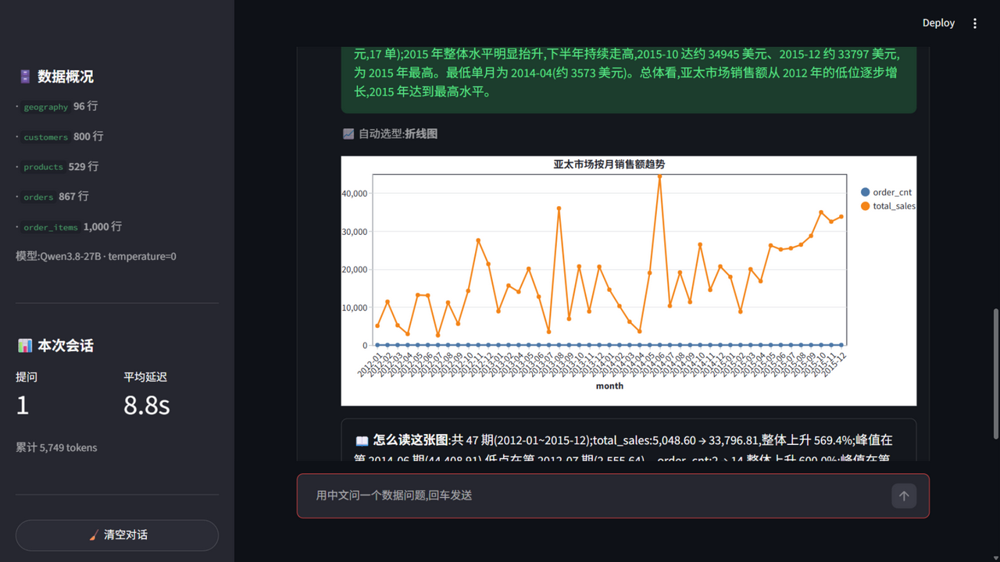
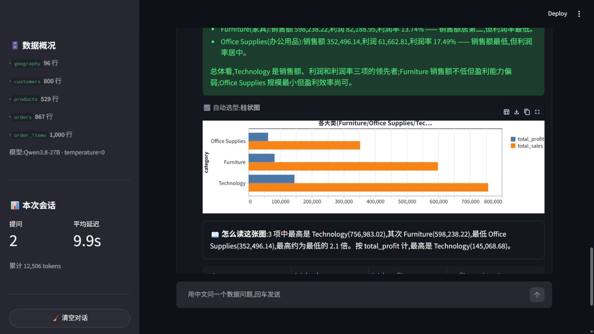
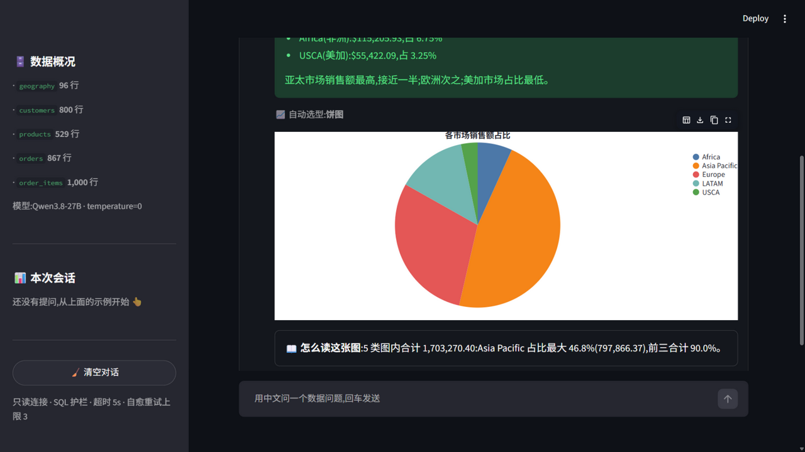

# chatbi · 数据分析 Agent(项目 2)

[](https://github.com/LyZheFeng/chatbi/actions/workflows/ci.yml)

中文自然语言 → 生成 SQL → 自愈执行(报错回传/结果反思)→ 图表 + 解读。
备考项目 2,对应 `../agent-internship-plan.md` Week 3(Day 15~21)。

## 当前进度:v0.1-chatbi(Day 21 收口:基础链路 + 自愈 + Schema 管理 + 图表解读 + 安全加固,均有真实跑分)

**链路**:中文提问 → function calling(`get_schema` / `execute_sql` / `final_answer`)→ SQLite 只读执行 → 自动选型图表 + 模板化解读 + 表格 + 中文结论 + 执行轨迹。

**自愈循环(Day 17-18)**:SQL 报错 → 错误分类提示回传 → 修正重试(连续失败上限 3 次即优雅降级);空结果/全 0 触发反思提示,由模型判断"SQL 写错还是数据如此";`self_heal` 可关。25 题评估(temperature=0,`eval/results.md`):

| 条件 | 执行准确率 |
|---|---|
| 自然 · 自愈关(Day 17-18 基线,25 题) | 92.0% |
| 自然 · 自愈开(Day 17-18 基线,25 题) | 92.0%(该模型在注释 DDL 上首错率为 0,自然无差异) |
| 自然 · 自愈开(Day 19 Schema 注入后,25 题) | 96.0%(24/25,唯一失手为偶数行中位数语义盲区) |
| 故障注入⚡ · 自愈关(25 题) | **0%**(首错即降级,不编造) |
| 故障注入⚡ · 自愈开(25 题) | 88%(22/25 一次修正恢复) |
| 自然 · 自愈开/关(**Day 21,50 题**) | **100.0%**(50/50;中位数口径入提示后 q25 修复) |
| 故障注入⚡ · 自愈关(Day 21,50 题) | **0%**(50 题全部优雅降级,明确报因) |
| 故障注入⚡ · 自愈开(**Day 21,50 题**) | **100.0%**(50/50,全部"错误回传→一次修正"恢复;Day 19 消掉枚举探查步数后,自愈上限从 88% 上移) |

- 数据:Global Superstore(公开电商订单数据集,1000 行明细)整理成 5 张关联表
  (geography / customers / products / orders / order_items),DDL 内嵌中文列注释;
  确定性注入 5 类脏数据(region 缺失 / 数量 0 与负数 / 销售额缺失 / 发货早于下单 / 邮编大面积空)。
- **Schema 管理(Day 19)**:低基数码列(market/segment/category/sub_category/ship_mode/order_priority)
  的枚举取值、日期覆盖范围、折扣范围由建库脚本**从数据动态计算**写进 DDL 注释
  (杜绝"注释写 APAC、库里存 Asia Pacific"式人手不一致);get_schema 输出头部固定带表关系图;
  order_date 注释带按月/按季度分组口径。效果:季度题(q20)一枪修复,枚举陷阱题(q06)从 5 步探查降为 1 枪。
- **图表 + 解读(Day 20)**:按最终表格的列结构确定性选型——时间列 → 折线(年+季度/年+月两列
  自动合成 "2014Q1"/"2014-03" 横轴;带分组列画多系列)、单维度 + 数值 → 柱/横条(问占比且全正
  ≤6 类 → 饼图)、两数值列 → 散点;`chart_spec` 是标准 Vega-Lite JSON(`AskResponse.chart_spec`,
  UI 与接口共用一份,`st.vega_lite_chart` 直接渲染)。图表下配模板化"怎么读这张图"(最值/趋势方向/
  峰值低点/相关性,数字全部来自本地执行结果,一个不新造)。脏数据呈现约定:只剔除"画不了"的行
  (字段 NULL,剔除行数写进解读),负值/0 照画并在解读中点名,表格始终全量——图表与结论同口径。
- **安全加固(Day 21)**:SQL 护栏三层——①连接 `mode=ro` 物理只读(最后防线);②token 级白名单:
  词法扫描让字符串/引号标识符/注释各自成 token,首 token 必须 SELECT/WITH、禁分号拼多条、
  禁 PRAGMA/ATTACH/EXPLAIN 等语句关键字与 load_extension/randomblob/pragma_* 等危险函数;
  ③执行超时(progress_handler 按秒掐断无界递归 CTE / 笛卡尔积一类算力攻击)+ 自动 LIMIT(LIMIT 子句
  同样按 token 判定,字符串/注释里的 'limit' 骗不过)+ cap 截断。
- **生产化最小保护(外部评审两轮修复)**:每请求连接 finally 回收;可选 API Key 鉴权
  (`api_key` 配置非空即启用,请求带 `X-API-Key`);可选按 IP 固定窗口限流
  (`rate_limit_per_min`,超限 429,进程内计数);每请求 `X-Request-Id` 响应头 + 结构化访问日志;
  LLM 并发闸门(全局信号量 `llm_max_concurrency`,排队超时转"LLM 繁忙"降级,不占线程死等)+
  token 用量统计(`stats.llm_tokens`,真实链路单题约 3.9k);service 未预期异常对外只给通用文案、
  完整堆栈进服务端日志;建库脚本原子替换(先写 .tmp 自检再替换,旧库滚动备份 .bak/.bak.1/.bak.2);
  LLM 走 openai SDK 内建重试(`llm_max_retries` 显式配置);依赖显式声明(含 pandas)并锁版本
  (`requirements.lock`,CI 先验证 requirements 自足再用 lock 锁版本),CI 在 ubuntu/windows 双平台跑测试。
- 纪律:所有 tool_call 参数过 pydantic 严格校验;表格数据一律来自本地执行
  (final_answer 自报 SQL 本地重执行,保证展示表格与结论锚定同一条 SQL);
  步数耗尽/拒绝调用工具时优雅降级,error 字段说明原因,绝不编造。
- 接口:FastAPI `POST /ask`;界面:Streamlit(`app/ui.py`)。
- 测试:`pytest tests` 76 例(工具校验、SQL 护栏 token 白名单/超时/原子建库、agent 循环与自愈逻辑
  FakeLLM 脚本驱动、LLM 并发闸门与 token 统计、图表选型/解读/脏数据约定、API 鉴权/限流/异常兜底、
  DDL 注释↔数据一致性回归),不依赖网络;pytest.ini 把临时目录固定在仓库内(`.pytest_tmp`)。
- 未做、留给部署层(见 PROGRESS 路线图):分布式限流与 Prometheus 指标、异步任务队列/多 worker、
  熔断/fallback 模型、结构化查询意图与语义校验、schema 按需检索。

## 界面







## 本地运行

```bash
# 1. 环境(Windows,Python 3.13)
/d/python/python.exe -m venv .venv
.venv/Scripts/python.exe -m pip install -r requirements.txt   # 可复现安装用 requirements.lock
cp .env.example .env                # 内网 vLLM 配置

# 2. 建库(源数据放 data/raw/,来源见 scripts/build_db.py 头注释)
.venv/Scripts/python.exe -X utf8 scripts/build_db.py

# 3. 演示
.venv/Scripts/python.exe -X utf8 scripts/demo_ask.py       # 命令行端到端
.venv/Scripts/python.exe -X utf8 -m uvicorn app.api:app --port 8000          # 单 worker 演示
.venv/Scripts/python.exe -X utf8 -m uvicorn app.api:app --port 8000 --workers 4   # 多 worker(注意:限流计数是进程内的)
.venv/Scripts/python.exe -X utf8 -m streamlit run app/ui.py

# 4. MCP server(stdio transport;进程内不要 print 到 stdout,那是协议通道)
.venv/Scripts/python.exe -m app.mcp_server
# 用 MCP Inspector 调试(CLI / Web UI 二选一;配置已写好)
npx @modelcontextprotocol/inspector --cli --config scripts/mcp-inspector.json --server chatbi-db --method tools/list
npx @modelcontextprotocol/inspector --config scripts/mcp-inspector.json   # Web UI,浏览器打开后连 chatbi-db
```

## MCP 工具设计(Day 22,官方 SDK `mcp` 2.x,stdio transport)

设计原则:**MCP 是工具的传输协议,不改工具的语义**。`app/mcp_server.py` 不重写任何护栏,
直接复用 `app/db.py` 的三层防护(mode=ro 只读连接 + token 级 SELECT 白名单 + 执行超时);
agent 编排(final_answer 循环、反思提示)留在客户端——server 只回答"这一条查询的结果是什么"。

三类原语各司其职:

| 原语 | 定义 | 谁来调用 | 为什么用它 |
|---|---|---|---|
| **tools** | `get_schema(tables?)`、`execute_sql(sql)` | 模型,带参数 | 参数化查询,模型按需调用;与 function calling 版同名同义,零学习成本迁移 |
| **resources** | `chatbi://schema`(全量)、`chatbi://tables/{table}`(模板) | 客户端,按 URI 读 | 静态上下文按址复用,不占工具调用轮次;单表 DDL 做成模板避免 5 份冗余资源 |
| **prompts** | `analyze_data(question)` | 用户主动触发 | 把查询纪律(SQL 口径约定 + 已知脏数据说明)封装成模板,任何 MCP 客户端拿到同一套口径 |

错误也是接口的一部分:护栏拒绝与 SQL 执行错误转换为 `isError=true` 的结果、**原始消息完整回传**
(如 `ValueError: 仅允许 SELECT / WITH 开头的只读查询`),客户端模型据此修正重试——
自愈循环的信号在 MCP 通道下不丢失;其他异常由 SDK 统一 mask,不泄漏服务端内部细节。

验证(`tests/test_mcp_server.py`,3 例,走真实 stdio 子进程):三类原语的发现与调用、
护栏错误回传、**50 题 gold SQL 经 MCP 通道与本地直连逐题结果一致**;MCP Inspector CLI 与
Web UI 均实测通过(tools/resources/prompts 三个页签 + 错误注入)。

## 计划(详见 PROGRESS.md)

Day 19 ✅ Schema 管理 → Day 20 ✅ 图表 + 解读 → Day 21 ✅ 安全加固 + 50 题评估
(自然 100%,注入 100% 恢复)→ 已打 tag **`v0.1-chatbi`** →
Day 22 ✅ MCP 化:数据库查询 server(Inspector 调通,50 题 gold 双通道一致)。
